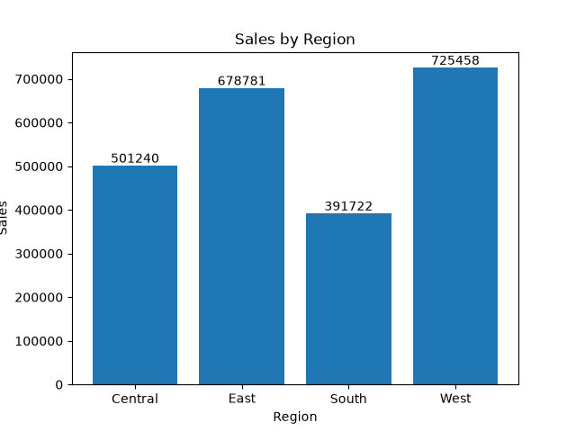
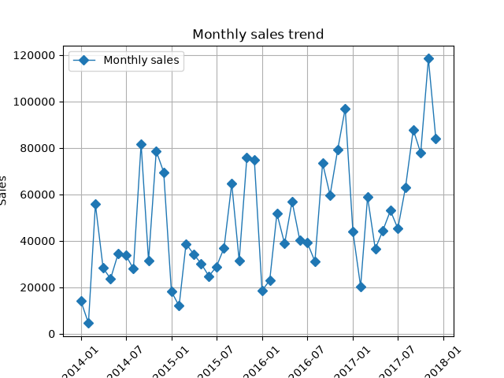
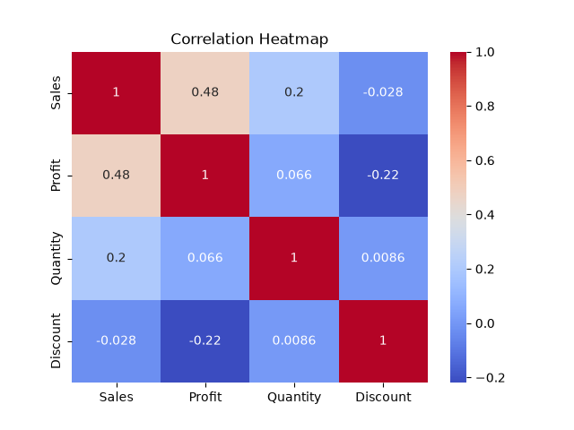
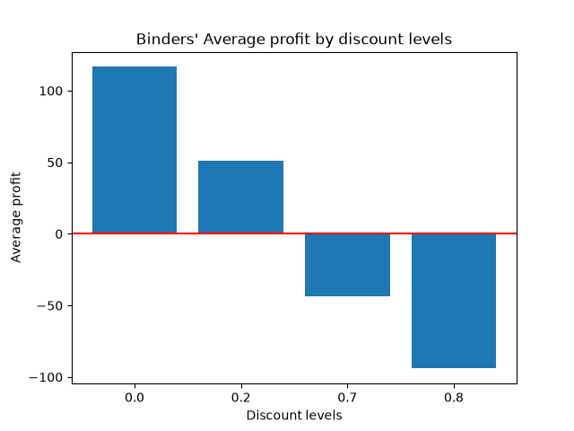

# Superstore Sales Analysis
## Business Problem
Often times, retail businesses offer discounts aiming to attract customers and increase profits. However, excessive discounts may result in losses. This project analyzes superstore sales, profit, product categories and discount levels to identify factors leading to negative profits.
## Objective
To analyze sales, profit and discounts using Python and pandas, identify patterns in business performance and investigate the relationship between discounts and profit.
## Dataset
The project uses Superstore sales dataset with orders, products, customers, discounts, profits information.The dataset was cleaned and analyzed.
## Tools and Libraries
- Python: used for the analysis.
- pandas: used to load and clean the data.
- Matplotlib: used to create charts and for visualization.
## Data Analysis and Findings
1. Sales Performance by Region
To help identify region differences in sales performance, a bar chart was created.

2. Monthly Sales Trend
A line chart was created to examine how sales changed over time.

3. Relationship between Discount and Profit
With the help of a heatmap, correlation analysis was performed to investigate the relationship between discount and profit. With an approximate correlation of -0.22, it was suggested that higher discounts were generally associated with lower profits. However, this does not prove that discounts directly caused lower profits.

## Product Profitability Analysis
Profit was examined across different product categories and sub-categories to identify areas where the business experienced losses. 
On high discount levels of 50% and above, with -47140 office supplies were the leading category that had negative profits.
And among the sub-categories, binders with $-38510 that showed  negative profit values. Further investigation into discount levels may help the business determine factors contributing to these losses and make better pricing decisions.

## Business Recommendations
1. Review discount strategies
Evaluate discount levels to determine whether high discounts result to losses.
2. Investigate loss-making products
Further investigation of Binders, Appliances and other products with negative profits to identify causes of the losses.
3. Monitor regional sales to identify areas performing well and those requiring additional attention
4. Make data-driven decisions
Regularly analyze sales, discounts and profits to improve business performance.
## Conclusion
This project used Python, pandas and Matplotlib to analyze Superstore sales data. The analysis examined regional sales performance, monthly sales trend, category sales performance and the relationship between sales, profit, quantity and discounts.
The correlation analysis revealed a weak negative relationship between discounts and profit. The analysis also identified loss-making sub-categories, including Binders.
Thi project demonstrates how data analysis can help businesses identify performance patterns, investigate profitability and make more informed decisions on pricing and sales strategies.
## Skills demonstrated
1. Data cleaning and manipulation using pandas
2. Exploratory data analysis
3. Correlation analysis
4. Data visualization with Matplotlib
5. Business interpretation
